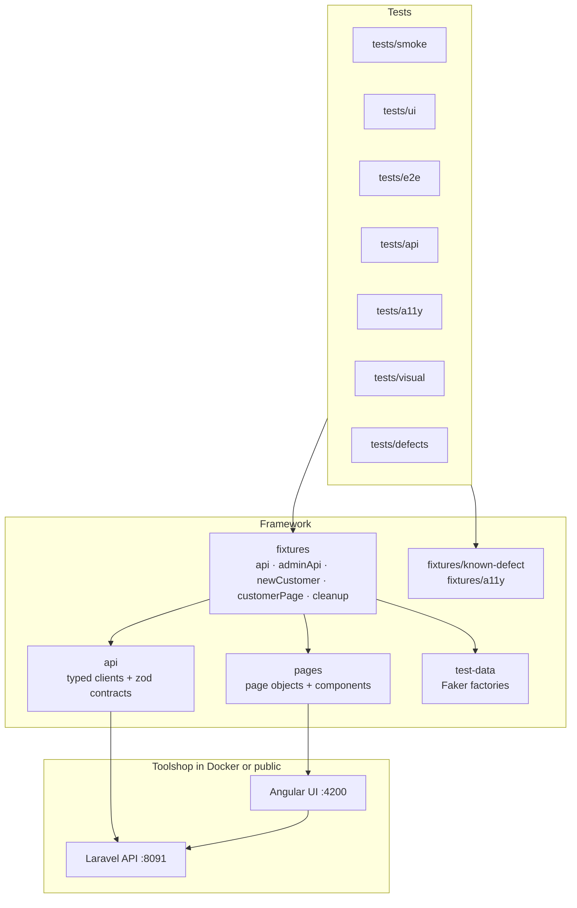

# Toolshop Playwright framework

[](https://github.com/afzal-ahmed-qa/toolshop-playwright-framework/actions/workflows/ci.yml)


A test framework for [Toolshop](https://github.com/testsmith-io/practice-software-testing), a realistic
web shop with customers, admins, a cart and a four-step checkout. It covers the UI, the REST API,
accessibility and visual regression, and it runs against **its own copy of the shop in Docker**,
started fresh in CI on every run.

Latest report (every test with trace, screenshots and video on failure):
https://afzal-ahmed-qa.github.io/toolshop-playwright-framework/

I tested the Toolshop API with Postman before
([toolshop-api-tests-postman](https://github.com/afzal-ahmed-qa/toolshop-api-tests-postman)). This project
goes further: typed API clients with schema checks, UI journeys verified against the API, and a CI
pipeline that owns its test environment. The work was planned as
[17 issues in 3 milestones](https://github.com/afzal-ahmed-qa/toolshop-playwright-framework/milestones?state=closed)
and built through pull requests.

## What's tested

| Area                      | Tests | Examples                                                                                                                         |
| ------------------------- | ----- | -------------------------------------------------------------------------------------------------------------------------------- |
| API                       | 38    | Contracts with zod, access control (role × endpoint table), validation and boundaries, orders placed without a browser           |
| UI                        | 21    | Search, filters, sorting and pagination compared with the API response; network mocking (empty, slow, failing, edge-case data)   |
| End to end                | 3     | A customer buys two products and the stored invoice is checked; admin and shopper in separate browser contexts; a rejected order |
| Accessibility             | 7     | axe WCAG 2.1 A/AA scans of 6 pages incl. checkout, keyboard-only login                                                           |
| Visual                    | 4     | Navbar, product card, product details, cart; screenshots taken in the Playwright Docker image                                    |
| Smoke                     | 4     | Home page, saved logins for customer and admin, a fresh customer                                                                 |
| Defects (with-bugs build) | 7     | Security and data defects in the build with planted bugs                                                                         |

**17 documented defects** in [docs/defects.md](docs/defects.md), each with steps, expected and actual
result, and a test. The most serious: anyone can create products without logging in (DEF-01), and in
the with-bugs build customers can read every user's password hash (WB-03) and invoices are readable
without a login (WB-04).

## How it's put together



**Test data through the API.** The `newCustomer` fixture registers a fresh customer for each test,
with an address taken from the shop's postcode lookup (the API rejects addresses whose city does
not belong to the postcode). `customerPage` puts that customer's token into the browser, so the test
starts logged in. Seeded admin and customer logins are saved once by a `setup` project and reused.

**UI checked against the API.** Grid actions return the exact response the browser received, and
the tests check the rule on that data (sorted, filtered, matching) and then that the grid shows
exactly it. Prices and products are never hard-coded: on the public site other testers change
them all day; during development a product price changed from $14.15 to $59.99 and a whole
product was deleted.

**Contracts.** Every API response is parsed with a zod schema. Three API inconsistencies were found
this way (DEF-05, DEF-06, DEF-07).

**Known defects without hiding errors.** `test.fail()` turns _any_ error into a pass. It once hid a
contract error and left test products on the public site. `expectKnownDefect()` only expects the
defect assertion itself to fail; setup errors still fail, and if the defect is fixed the test says so.

**Clean-up in fixtures, not in `finally`.** After a timeout Playwright closes the API context
before a `finally` block runs. Products created by a test are registered with the `cleanup` fixture,
whose teardown always runs.

**No hard waits.** Tests wait for responses and web-first assertions. ESLint forbids
`waitForTimeout` and `force: true`.

## Running it

Node.js 20 or 22.

```bash
npm ci
npx playwright install --with-deps chromium
cp .env.example .env          # ENV=public by default, no Docker needed
```

```bash
npm test                      # everything against ENV (setup, api, chromium)
npm run test:pr               # @smoke + API, what pull requests run
npm run test:api              # API only, no browser
npm run test:e2e              # the journeys
npm run test:a11y             # accessibility scans
npm run test:with-bugs        # defect tests against the with-bugs build
npm run test:visual:docker    # visual tests inside the Playwright image (needs ENV=local)
npm run test:ui               # Playwright UI mode
npm run report                # open the last HTML report
npm run lint && npm run typecheck
```

`ENV` selects the shop: `local` (Docker, see [docs/local-setup.md](docs/local-setup.md)), `public`
or `with-bugs`. `BASE_URL` and `API_URL` override the preset.

## CI

[`ci.yml`](.github/workflows/ci.yml):

- **Pull requests:** lint, Prettier, TypeScript, then `@smoke` and API tests against the public site.
  Both are required checks on `main`.
- **Push to `main`, nightly and manual:** the [`start-toolshop`](.github/actions/start-toolshop) action
  starts the shop from its Docker images with fresh seed data; the suite runs in **4 shards**, the
  visual tests run inside `mcr.microsoft.com/playwright:v1.57.0-noble`, and the blob reports are
  merged into one HTML report on GitHub Pages.
- **Nightly:** the with-bugs defect tests.

Two problems solved on the way: the published Toolshop web image only exists for arm64, so CI builds
it from the app's own Dockerfile; and the Docker run mounts the project at the same path as the
other shards, because `merge-reports` refuses blob reports from different test directories.

Visual baselines are made by a manual workflow ([`visual-baselines.yml`](.github/workflows/visual-baselines.yml)),
reviewed by eye and committed through a pull request.

## Next on my list

- Firefox and WebKit projects for the journeys.
- Performance checks of the product API with k6.
- Contract tests generated from the Toolshop OpenAPI definition.

---

Afzal Ahmed, [github.com/afzal-ahmed-qa](https://github.com/afzal-ahmed-qa)
